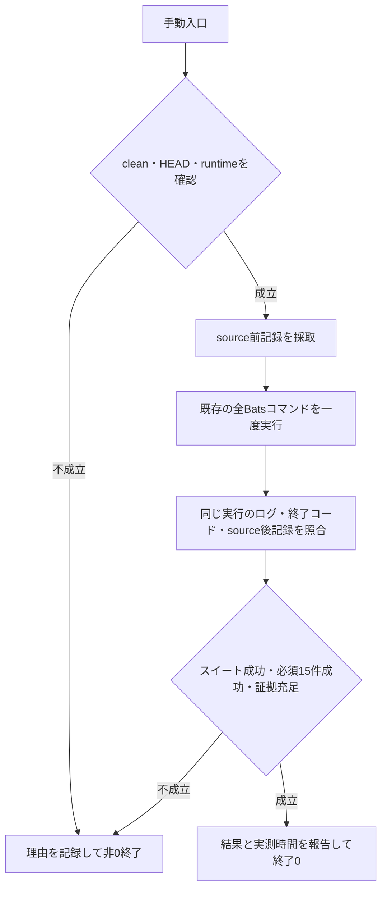

# canonical検証の証拠記録の設計（2026-10-15）

この記録は `$grill-with-docs` 中の合意と現状確認をまとめたもの。Q1–11はユーザーが各推奨案を採用し、設計全体の最終確認後に `$implement` を明示して実装・検証・レビュー・commitへの移行を承認した。

## 合意済み

- **Q1 — 実行証拠の照合から**: 成功報告の前に、証拠の欠落と異なる実行結果の混在を検出する。PR本文やCI記載漏れの照合は初回範囲外。
- **Q2 — dotfilesに限定**: 他repoへの配布は初回範囲外。
- **Q3 — 全Bats 1回分から**: 公開前のcanonical実行について、source・環境・TAP・終了コードを対応付ける。関連テストやAI/APM個別検証を共通集約する機能は初回範囲外。
- **Q4 — 新規実行時から記録**: 既存の検証コマンドを一度だけ実行し、開始前条件と終了後結果を記録して対応付ける。既存ログだけでは、実行前のHEAD/hashを後から証明できない。
- **Q5 — 必須証拠5点**: 対象worktreeと完全なHEAD、全trackedファイルの実行前後の内容一致、実行コマンドと使用したruntimeの記録、TAPと終了コードの整合、指定した必須fixtureの成功・skipなしを必須にする。
- **Q6 — 不足・不一致時の扱い**: Bats自体の結果と証拠照合の問題を区別し、必須証拠が不足・不一致なら全体を検証成功とせず非0終了する。原始ログを保持し、自動再実行はしない。既定のopt-in skipは許容し、指定必須fixtureのskipだけを不成立にする。
- **Q7 — 時間の計測範囲**: 全Batsを呼ぶ既存コマンドの開始から終了までの実測時間を必須にする。環境準備込みの総時間を記録する場合は別項目とし、実測・推定を明示する。
- **Q8 — 利用する入口**: 更新時に明示して使う手動入口から、既存の `lefthook run test` を一度呼ぶ。既存のログ保存とTAP検査を再利用する。
- **Q9 — 開始時のsource**: 作業ツリーがcleanで、検証する変更がcommit済みであることを開始条件にする。完全なHEADと実際の検証対象を対応付ける。
- **Q10 — 必須fixtureの初期設定**: 既存のDesign Hook 13件とPlaywright runtime 2件を既定セットにし、各名称の存在・成功・skipなしを照合する。件数だけでは判定せず、独立した名前一覧の変更をレビュー対象にする。
- **Q11 — runtimeの準備**: 必要なruntimeは既存手順で事前準備して渡す。入口は準備状態を確認し、不足時はBats開始前に理由を返す。Nix buildやAPM再生成は既存の準備手順で行う。

## 確認した事実

- [`scripts/test.sh`](../../scripts/test.sh) は `tmp/test-run.*` にTAP、setup、environment、exit-codeを残す。Batsが終了コード0の場合、TAP plan、連番、失敗結果、bailoutを確認する。
- 同じ入口は通常の `bun run test` と `lefthook run test` から使われ、[`tests/test-entry.bats`](../../tests/test-entry.bats) はGitのないfixtureへ入口をコピーして検証する。
- 生成した `tmp/test-run.*` を呼出元へ機械的に返す手段は現状ない。内部変数の値をstderrへ人向けに表示するだけである。test-entryのfixtureは入口を再実行し、export済みの環境変数も継承する。
- 既定にするDesign Hook 13件とPlaywright runtime 2件のテスト名は、現在のtop-level `tests/*.bats` 間で重複していない。
- [`scripts/verify-ai-tools.py`](../../scripts/verify-ai-tools.py) は `metadata.json`、`paths.tsv`、`startup.log`、`exit-code` を保持し、sourceから選ばれた実行パスを照合してからCLIを起動する。集約コンソールには個別パスを出さない。
- 直近のPR #408では、一時記録のconsole由来パスがnullだったため `startup.log` を根拠に補正した。本実行時間1119.94秒とlauncher総時間の推定値1164.44秒は別の計測境界である。最初のlauncher失敗（127、Bats未開始）も本実行とは分けて保持した。過去の `tmp` JSONのキーは現行仕様を意味しない。

## 実装へ渡す設計案

手動入口は、検証対象のlinked worktreeと完全なHEAD、clean状態、事前準備したruntimeを確認し、全trackedファイルの記録を採取してから `lefthook run test` を一度だけ呼ぶ。終了後に同じ実行のTAP・終了コード・runtime記録を読み、sourceの前後記録と必須fixtureを照合する。既存コマンドの開始から終了までを実測し、スイート結果と証拠照合の結果を区別して報告する。

初期の必須fixtureは、base `bf31e700feef5ba9443c367e0d6d087ca757c894` の `tests/design-hook.bats` にある13のテスト名と `tests/playwright-runtime.bats` にある2つのテスト名で固定する。今回実行したTAPや変更中のテスト定義から期待する一覧を動的に作らず、各名称が結果に一度ずつ現れて成功し、skipされていないことを確認する。

ログの対応付けに最新directory探索や人向けconsoleの表示解析は使わない。`scripts/test.sh` が生成したログ先をその呼出元へ一意に返す最小限の連携だけを追加する。連携しない通常実行の挙動は維持し、受渡し情報はテスト内の別runnerへ引き継がない。実際のCLI名や内部項目名は実装時に既存の規約に沿って決める。

runtimeは既存のrunnerの記録と、明示した非秘密の実行パスを根拠にする。宣言値と実行記録を区別し、環境変数の実値全体を列挙しない。AI/APM個別gateの採否や6AIの版・output一致をこの入口で再判定する機能は追加しない。

### 受入確認

- 正常な全suiteのTAP・終了コードと、必須15件それぞれの存在・成功・skipなしを照合し、成功・skip・失敗の件数を分けて報告できる。suite全体の総件数は固定値にしない。
- 異なる実行のログ混入、ログ受渡しの欠落、source/HEADの前後不一致、欠けたまたはskipされた必須fixtureを成功として扱わない。
- clean条件やruntimeの準備状態が不成立ならBatsを開始しない。実行開始後の失敗・中断では元のログを保持し、成功にせず、自動再実行もしない。
- 通常のテスト入口と、Gitのないfixtureからの入口利用を維持する。テスト内で別runnerが起動しても外側の実行のログ参照を上書きしない。

sourceの照合は前後のHEAD・追跡対象・内容に対するもので、実行途中だけの変更や全filesystemの不変を保証するものではない。この記録が示すのは検証した時点のsourceと結果であり、後続のPR HEADやlive配備との一致確認は別の手順に残す。

## 最終確認

目的・範囲・合格条件・利用方法についてQ1–11の判断は完了し、最終確認への回答である `$implement` により設計全体の合意が成立した。同じtask worktreeで実装phaseを継続する。

テスト境界は、受入確認で合意した手動入口のコマンドと、既存runnerのログ先受渡しとする。前者は終了結果・保存した証拠と不足や混在の拒否を、後者は通常実行・入れ子のrunner・非Git fixtureとの互換性を確認する。外部コマンドをfixtureへ置き換える関連検証と、準備済みの実runtimeでの全suiteを区別する。

## 今回の境界

記録はこのrepoの手動入口が使う最小限に留める。汎用evidence JSON schemaやworkflowへ自動配線する新しいgate、上流skillのforkは導入しない。既存の準備・個別検証を一括実行する仕組みやPR本文・CIの照合も今回の範囲外とする。

用語集には合意した範囲の `canonical検証` を記録する。この変更はrepo内で容易に戻せる手動検証の改善であり、ADRの採用基準である変更コストの大きい判断には当たらないため、ADRは追加しない。

参照: [ADR-0004](../adr/0004-fill-mattpocock-gaps.md)（旧機構の境界）、[ADR-0041](../adr/0041-adopt-mattpocock-v1-2-3-workflow-semantics.md)（schema/gate境界）、[ADR-0071](../adr/0071-adopt-mattpocock-standard-workflow.md)（標準workflow）、[ADR-0046](../adr/0046-separate-orca-native-worktree-entry.md) および [`runtime/skill-harness.md`](../../runtime/skill-harness.md)（native worktree入口）。

## 実装と関連検証

手動入口は `scripts/verify-canonical.py`。標準ライブラリだけを使い、source・runtime・TAP・必須fixture・実測時間をその試行の記録として保持する。既存runnerへの追加は、呼出元が用意した専用directoryへログ先を返す連携と、子への受渡し情報の継承解除に限定した。元のログを保持し、TAPのSHA-256、コマンドとrunnerの終了コード、中断シグナルを区別して記録する。

ログ受渡し不在と実行runtime記録の空欄、中断の未伝達、中断時の実コマンド終了コードの取り違え、helpによる意図しない全suite開始を、回帰テストで失敗させてから修正した。手動入口のfixtureは実Git linked worktreeと実runnerを使い、外部のlefthook・Bun・Batsだけを置換する。source/HEAD/runtimeの変更、必須名の欠落・重複・skip、異なる実行の参照、非Gitの通常入口も検査する。

source-selected user/repo両wsl devShellの準備は成功し、PlaywrightとImpeccableのoutputと実行パスを照合した。既存frozen runtimeのmanifest/lockはsourceとbyte一致している。関連検証は準備済みdevShellで29件（29 pass／0 skip／0 fail、exit 0、18.627秒）を確認した。ここまで全suiteは未実行で、独立レビューと固定HEADでのcanonicalを後続に残す。証拠は `tmp/canonical-implementation-20261015/` の `related-prepared-result.json`、`related-prepared.tap`、`preparation-result.json`、`prepared.json`。
